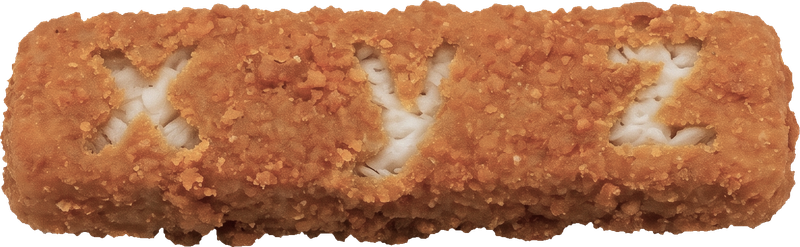

<p align="center">
  
</p>

# Fishstick: Persona Queries

[](https://huggingface.co/datasets/EdwardHuy/persona-queries)
[](https://huggingface.co/EdwardHuy/persona-embeddings)

Code for generating short retrieval queries from the personas in
[Nemotron-Personas-Belgium](https://huggingface.co/datasets/nvidia/Nemotron-Personas-Belgium),
plus an audit of the quality of those source personas.

For every persona a local LLM writes three short queries in Dutch or English
("Someone who ..."), each combining two different narrative fields of the profile.
The resulting dataset is published as
[EdwardHuy/persona-queries](https://huggingface.co/datasets/EdwardHuy/persona-queries)
and used to fine-tune the [Fishstick embedding models](https://huggingface.co/EdwardHuy/persona-embeddings)
in [persona-embeddings](https://github.com/schwaartz/persona-embeddings).

## Setup

Requires [uv](https://docs.astral.sh/uv/) and, for generation, [Ollama](https://ollama.com).

```bash
uv sync
ollama pull qwen3.5:9b
```

## Generating queries

```bash
uv run python src/generate_queries.py --language nl --count 4000
uv run python src/generate_queries.py --language en --count 4000
```

The first run downloads the Nemotron personas to `data/nemotron/`. Queries are written
to `data/queries/<language>.jsonl`, one persona per line:

| Field | Content |
| --- | --- |
| `uuid` | Nemotron persona ID (the same person in both languages) |
| `language` | `nl` or `en` |
| `queries` | the three generated queries |
| `source_fields` | for each query, the two persona fields it was written from |
| `profile` | the full persona as `[field] value` lines |
| `model` | the Ollama model that wrote the queries |

Personas whose queries fail the checks after two repair attempts are listed in
`data/queries/<language>.failures.jsonl`. A run can be stopped at any time; the same
command resumes it, and a larger `--count` extends it.

## Exporting for Hugging Face

```bash
uv run python src/export_dataset.py
```

This writes `data/hf/nl_BE.jsonl` and `data/hf/en_BE.jsonl`, the files of the published
dataset: one row per persona with its `uuid` and `query_1` to `query_3`. The profiles are
left out, since they can be joined back from Nemotron-Personas-Belgium on `uuid`.

## Audit of the source personas

Two LLM auditors (Claude and GPT) labelled 500 personas (250 Dutch, 250 English) for
contradictions, language defects, broken content and incorrect real-world references.
A human made the final decision on the flagged contradictions and references.

- `audit/data/`: the audited personas, the rubric, a pilot probe, both auditors'
  annotations and the final decisions (`review.json`).
- `audit/analyze.py`: recomputes prevalence, inter-auditor agreement and review
  outcomes into `audit/results/`.

```bash
uv run python audit/analyze.py
```

## License

This project is licensed under the [Creative Commons Attribution 4.0 International License (CC BY 4.0)](https://creativecommons.org/licenses/by/4.0/). See [LICENSE](LICENSE) for the full text.
